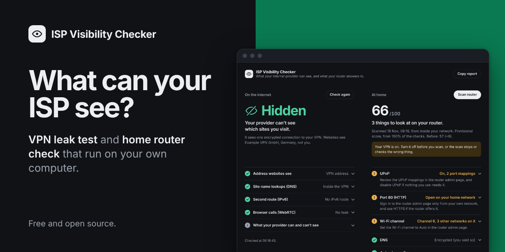
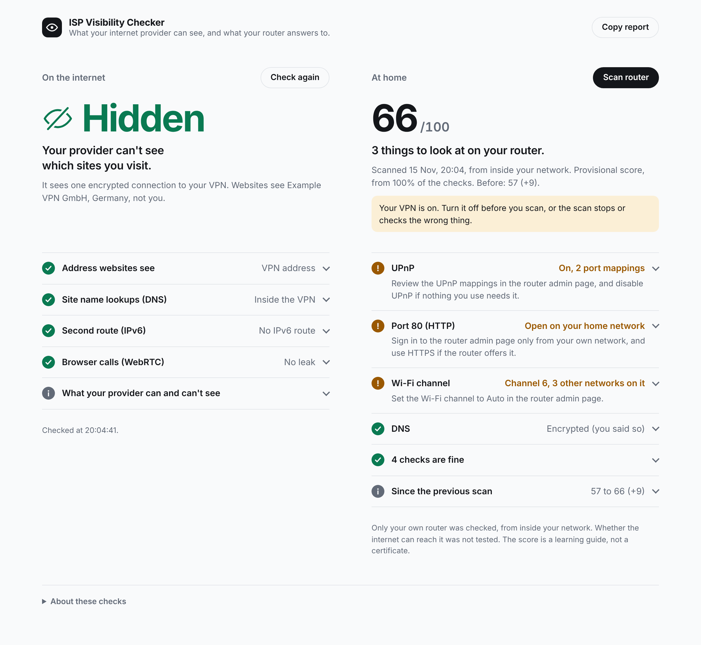

# ISP Visibility Checker: VPN Leak Test and Home Router Check

A local Node.js app that tests your VPN for IP, DNS, IPv6 and WebRTC leaks, and runs a read-only security check of your own home router. It answers in plain words: what your internet provider (ISP) can see right now, and what your router answers to.

[](LICENSE)
[](https://nodejs.org)
[](https://github.com/Basitx72/isp-visibility-checker/stargazers)
[](https://github.com/Basitx72/isp-visibility-checker/commits/main)

<!-- Demo slot: record a short screen capture, save it as docs/demo.gif, and replace the image below with it. -->


The picture shows sample data, not a real network.

## Features

- **VPN leak test.** Checks the address websites see, DNS lookups, IPv6 and WebRTC, then answers in one word: Hidden, Partly visible or Visible.
- **What your ISP can and can't see.** A short list for your current connection.
- **Home router check.** Looks at ports 22, 23, 80 and 7547, UPnP and its port mappings, Wi-Fi security and channel crowding, then gives a score out of 100.
- **Read-only by design.** It connects and closes. It never sends data to the router, never tries passwords and never changes a setting.
- **Local and private.** No account and no tracking. Scan results stay on your computer.
- **Changes over time.** Each router scan is compared with the one before, and `watch.js` can repeat the scan every 30 minutes.

## Quick Start

```bash
git clone https://github.com/Basitx72/isp-visibility-checker.git
cd isp-visibility-checker
npm install
node app.js
```

The terminal prints the app's address, usually `http://localhost:4747`. On macOS the app opens in your browser by itself. On other systems, open that address yourself. Press Control-C in the terminal to stop the app.

## Installation

### Requirements

- [Node.js](https://nodejs.org). The project was written for Node 26. On another version, npm prints a warning.
- A modern browser such as Chrome.
- macOS for the router scan. Other systems are untested.

### Scan your router

Turn your VPN off, then press **Scan router**. With a VPN on, your computer's default gateway is the VPN, not your router.

### Other ways to run it

| Command | What it does |
| --- | --- |
| Open `ISP Visibility Checker.html` in a browser | Runs the VPN leak test only, with no install |
| `node scanner.js --dns unknown` | Runs the router check in the terminal |
| `node watch.js` | Repeats the router check every 30 minutes and reports only changes |

## How It Works

### VPN leak test (in your browser)

| Check | What it answers |
| --- | --- |
| Address websites see | Do sites see you, or a VPN server? |
| Site name lookups (DNS) | Who looks up site names for you? Whoever does it can list the sites you open. |
| Second route (IPv6) | Does IPv6 traffic go around the VPN? |
| Browser calls (WebRTC) | Can calls and video chats reveal your address? |

The answer is one word:

- **Hidden**: websites see a VPN address, and nothing leaks past the VPN.
- **Partly visible**: the VPN is on, but DNS, IPv6 or WebRTC leaks past it.
- **Visible**: there is no VPN, so your provider can see which sites you visit.

### Home router check (`scanner.js`)

| Check | What it does |
| --- | --- |
| Ports 22, 23, 80 and 7547 | Connects to your router and closes again. It sends no data. |
| UPnP | Reads whether it is on and which port mappings exist. It changes nothing. |
| Wi-Fi | Reads the security mode and how crowded the channel is, as your system reports them. |
| DNS | Uses your own answer: encrypted, not encrypted, or unknown. |

The result is a provisional score, a note on how much evidence it rests on, and a short list of things to look at.

### The app (`app.js`)

`app.js` is a small server that listens on your own computer only (`127.0.0.1`). It serves the window and runs `scanner.js` when you press **Scan router**. It answers only its own window.

## Comparison with Alternatives

Each half of this app exists elsewhere as a bigger tool. This project is the small one that puts both answers in one window.

| Tool | What it is | Pick it when |
| --- | --- | --- |
| [MyIP](https://github.com/jason5ng32/MyIP) | Web IP toolbox with WebRTC and DNS leak tests, speed test and many network tools (AGPL-3.0) | You want the most complete internet-side toolbox |
| [dnsleaktest](https://github.com/macvk/dnsleaktest) | Terminal script that tests for DNS leaks (MIT) | You want one command and no browser |
| [netcheck](https://github.com/r167/netcheck) | Terminal tool that audits the gateway in depth, including default-password tests (Apache-2.0) | You want a deeper router audit |
| [JimCKD's Router Checker](https://github.com/Hardware-Busters/router-checker) | Terminal tool that scans every device on the home network (MIT) | You want all devices checked, not only the router |

Pick this project when you want both answers in plain words, and a router check that only connects and closes.

## Safety Rules

- It looks only at the private default gateway of the computer it runs on. There is no way to give it another target.
- Port checks connect and close. UPnP is read-only.
- It never tests, or claims to know, what the internet can reach. A port that answers is "open on your home network". Missing evidence is reported as "Unknown".
- The full rules are in [CLAUDE.md](CLAUDE.md).

## Privacy

- The router scan saves two files, `sanitized-report.json` and `previous-sanitized-report.json`. They hold no network names, hardware addresses, device names or complete private addresses. Git ignores both.
- The VPN leak test saves nothing. It asks public services which address they see: ipquery.io, ipwho.is, geojs.io, Cloudflare, ipify.org, icanhazip.com, ip-api.com and ipleak.net, plus call servers at Cloudflare, Twilio, Google and Sipnet. Each one sees what any website would see.
- The window shows your own addresses. Hide them before you share a screenshot, and don't paste "Copy report" text in public.

## Limitations

- The VPN leak test covers this browser at this moment. It can't test a VPN's kill switch or other apps.
- The router check sees your router from inside your network only. The score is a learning guide, not a certificate.
- It was built and used on macOS. Other systems are untested.

## FAQ

### Can my internet provider see which sites I visit when I use a VPN?

With a working VPN, your provider sees that you are connected to a VPN server and how much data moves, not which sites you open. If DNS, IPv6 or WebRTC leaks past the VPN, part of that becomes visible again. Those three leaks are what this app tests.

### What is a DNS leak?

A DNS leak is when the lookups that turn site names into addresses go to your provider instead of through the VPN. Your provider can then list the sites you open, even though the VPN hides the rest.

### Does the router check attack or change my router?

No. It connects to four ports and closes, and it reads what UPnP reports. It sends no data, tries no passwords and changes no settings.

## License

[MIT](LICENSE)

## About

This started as a NextWork project and was built with Claude, Anthropic's AI assistant.
